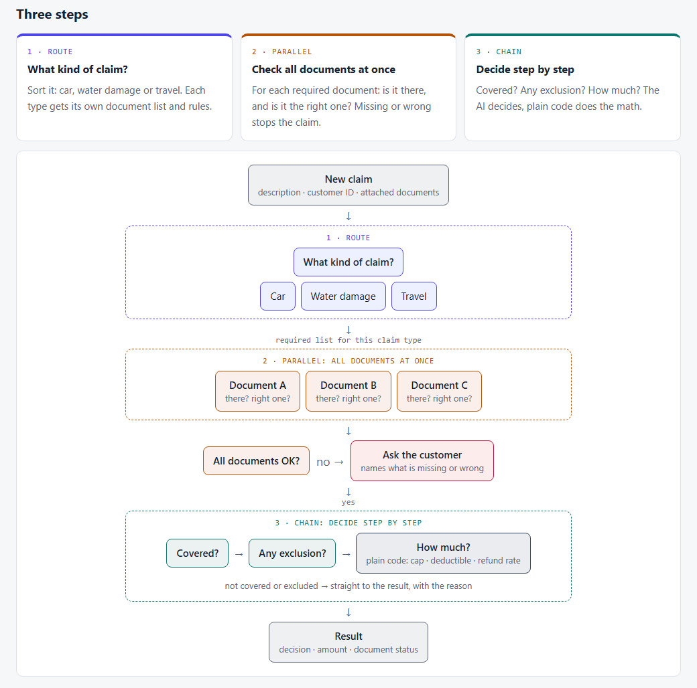

# 01 · One big prompt or a workflow?

## How this started

So, I came across Anthropic's cookbook post [Basic Multi-LLM Workflows](https://platform.claude.com/cookbook/patterns-agents-basic-workflows). It shows three ways to split one job across several model calls: **chain** the steps one after another, run them **in parallel**, or **route** each input to a specialist prompt.

It made me wonder. When I build something with an LLM, my first try is almost always one long prompt: here's everything, decide. It's simple, cheap and fast. Would splitting the job actually give better answers? And what would it cost me in time, money and things that can break?

The post doesn't say. So I tried to find out.

## What Anthropic claims, and what it implies

The post is short and practical. Each pattern gets one small example:

1. **Chain:** turn a plain-text quarterly summary into a table, in four steps.
2. **Parallel:** ask how a market change affects four groups (customers, employees, investors, suppliers), all at the same time.
3. **Route:** sort three support tickets into billing, technical, account or product, then answer each with that team's prompt.

The claim is in one line at the top: these workflows **"trade off cost or latency for potentially improved task performances."**

What it implies: **if you pay a bit more in calls and time, you get a better answer.**

But the post is honest about what it is. It calls the code **"sample implementations meant to demonstrate core concepts - not production code."** It prints the outputs and stops there. No accuracy, no cost, no timing.

So it shows *how* to build each pattern. It never tests the word **"improved"**.

## My experiment

So I decided to take it a step further and run my own experiment.

### The question

**If I give the same job to one big prompt and to a workflow that splits it, with right answers known in advance, which one gets more right, and what does each cost?**

### The data

I know insurance claims from the inside, so I started there. A customer sends a claim: a short description, a customer ID and some attached documents. The system must decide: **pay in full**, **pay in part**, **decline** (with the reason), **ask for a document** (naming which one), or **hand it to a person**.

I wrote three short policy wordings for a made-up insurer (car, home water damage, travel), 21 customers, and two sets of 30 claims with their documents and the right answers:

- **Main set**, 30 claims. I was allowed to tune on this one.
- **Hard set**, 30 new claims I only used at the end: longer documents, extra attachments, numbers that don't agree, facts buried in long text, and routing traps (a car flooded in a parking garage is a car claim, not a home claim). What makes each one hard is in [`design/hard-set.md`](design/hard-set.md).

The weak spot: **I wrote both the questions and the answers.** That's why I ran the same test again on real contracts with lawyer labels, in [topic 02](../02-prompt-vs-workflow-contract-nli/).

### The process

I built the job five ways, adding one pattern at a time, so I can see what each one is worth:

- **Level 0 · one big prompt.** All three policy wordings, the customer's policies, the claim and its documents. One answer.
- **Level 1 · + route.** The model first decides the claim type, then a prompt with only that policy wording decides.
- **Level 2 · + parallel.** Before deciding, one call per required document checks it, all at the same time.
- **Level 3 · + chain.** Covered? → any exclusion? → read the numbers. Plain code computes the amount.
- **Level 0+ · one big prompt on a bigger model.** Is one smarter call better than a workflow of cheaper calls?

Levels 0–3 use `gpt-6-luna` (small and cheap). Level 0+ uses `gpt-6.1-sol`. Prompt caching was on everywhere. Each level ran 3 times.



## How I measure it

| What I measure | In plain words |
|---|---|
| ✅ **Decision right** | The decision matches the key (full / partial / decline / documents / person) |
| 💵 **Amount right** | The payout matches to the shekel |
| 📄 **Doc problems caught** | A document is really missing or wrong, and the system asks for exactly that one |
| 🚨 **False doc alarms** | The system asks for a document that was fine |
| ⏱️ **Time** | Seconds per claim |
| 💰 **Cost** | Dollars per 1,000 claims |

**What Anthropic's post suggests:** more calls cost more time and money, and **may** give a better answer.

**What I expected** (my guesses before running anything):

- The **workflow would be more accurate**, especially on the tricky claims, because each step gets a smaller, cleaner piece of the job.
- It would **cost more and take longer**. Fine, if the accuracy gain was clear.
- If it didn't beat one prompt, that's an answer too.

## The results

Full tables in [`results.md`](results.md).

### The main set

30 claims × 3 repeats. I ran the workflow once, found two bugs in it, fixed them, and ran levels 1–3 again.

| Level | Decision right | Amount right | Doc problems caught | False doc alarms | Time / claim | $ per 1,000 claims |
|---|---|---|---|---|---|---|
| 0 · one prompt | **100%** | 100% | 100% | 0% | 3.0 s | $0.11* |
| 1, first try | 76% | 89% | 72% | 0% | 3.6 s | $0.13 |
| 2, first try | 60% | 80% | 33% | 28% | 5.0 s | $0.39 |
| 3, first try | 59% | 81% | 33% | 31% | 6.2 s | $0.46 |
| 1, fixed | 99% | 99% | 100% | 0% | 4.2 s | $0.12 |
| 2, fixed | 96% | 97% | 72% | 0% | 5.9 s | $0.43 |
| 3, fixed | 94% | 97% | 78% | 0% | 7.8 s | $0.53 |
| 0+ · bigger model | **100%** | 100% | 100% | 0% | 2.9 s | $1.50 |

\* A little low: it ran right after an identical run, so most of the prompt was already cached. With normal caching it's about $0.14.

- **One prompt was right every time**, even on the small model. The workflow had nothing to fix.
- **The workflow's first try was much worse (59–76%).** Both bugs were in the glue between steps, not in the model's thinking.
- **Fixed, the workflow came close (94–99%) but never beat one prompt**, at 4–5× the cost and 2.5× the time.

I tuned those fixes on these same 30 claims, so the "fixed" rows are a best case. That's what the hard set is for.

### The hard set

30 claims no prompt was tuned on. I reviewed the answer key before the run. After it, I made one ruling (the burst water heater itself isn't covered, H-WAT-01), and the scores were re-computed from the saved runs, not re-run.

| Level | Decision right | Amount right | Doc problems caught | False doc alarms | Time / claim | $ per 1,000 claims |
|---|---|---|---|---|---|---|
| 0 · one prompt | **94%** | 93% | 89% | 4% | 3.5 s | $0.15 |
| 1 · route | **94%** | 94% | 89% | 6% | 5.4 s | $0.20 |
| 2 · + parallel | 76% | 83% | 67% | 25% | 6.6 s | $0.55 |
| 3 · + chain | 70% | 80% | 67% | 30% | 7.7 s | $0.61 |
| 0+ · bigger model | **96%** | 96% | 100% | 1% | 3.0 s | $1.76 |

- **Now one prompt does slip, a little (94%).** It missed a buried date once, and a friend's receipt split it every time (that claim can be read two ways).
- **Routing didn't help or hurt.** It caught both routing traps, but added a call.
- **The narrow document checks hurt most: 25–30% false alarms.** A checker that sees one document alone takes it word for word: a parked car "has no driver", so the driver's license is "wrong".
- **The chain can't say "part of it".** One excluded doctor's visit declined a whole medical claim, every time.
- **The bigger model was the most accurate and the fastest**, at about 11× the small model's cost.

## Key takeaways

- **I was wrong about the workflow.** One big prompt was the most accurate option on the small model, and the cheapest and fastest.
- **Splitting a job doesn't make the model smarter. It makes each call see less.** A document checker that can't see the rest of the claim flags things that are fine.
- **Most of the workflow's mistakes lived in the glue**, not in the model: an answer my code couldn't read, and a rule each step took too literally.
- **When one prompt wasn't enough, a bigger model fixed it better than splitting the job did.**
- **What the patterns are still good for:** routing cost almost nothing and helps when the rules don't fit in one prompt; letting code do the money math keeps amounts exact.

| Option | Use it when… | Skip it when… |
|---|---|---|
| **One big prompt** | Everything fits in one prompt and the model can read it together | It starts missing things you can name and test. Then try a bigger model first |
| **Route** | Each type needs very different rules, or the rules don't fit in one prompt | Everything already fits; it adds a call |
| **Parallel** | The checks truly stand alone, each in one short rule | A check needs the rest of the claim to judge it |
| **Chain** | You need to show each step, or the math must be exact, so code does it | A step must answer yes/no where the truth is "part of it" |

**My rule of thumb:** start with one prompt and a small test set with known answers. Split only the step you can **show** is failing, and measure again.

## Limitations

- **Made-up data:** 3 short policy wordings and 30 + 30 claims. Real policies and files are much longer and messier, and that's where routing and splitting should start to pay off.
- **The answer key is one person's reading** (mine). Two claims can be read two ways (the water heater, the friend's receipt).
- **One model family** (OpenAI), and 3 repeats per level. One claim is about 3 points, so small gaps may be noise.
- **Prompt caching was on everywhere**, which helps the long single prompt the most. Cache warmth also depends on run order, so the hard-set costs are the fairer ones.
- **Costs are tiny here** (under $2 per 1,000 claims at every level). The workflow's 4–5× cost only matters at real volume.

## Technical walkthrough

### The data

- **Policies:** three wordings in markdown ([`data/policies/`](data/policies/)): car comprehensive (assessor's report, listed drivers, minimum age), home water damage (add-on, slow leaks excluded, network vs private plumber), travel (medical abroad, trip cancellation).
- **Customers:** 21, each with their policies, caps and deductibles ([`data/customers.json`](data/customers.json)).
- **Claims:** 30 main ([`data/claims.json`](data/claims.json)) and 30 hard ([`data/hard/`](data/hard/)), each with its documents, and an answer key per set.

### The tools

| Tool | What I used it for |
|---|---|
| **Python 3** | Everything |
| **OpenAI API**, `gpt-6-luna` and `gpt-6.1-sol` | The model calls, through a small shared helper ([`shared/llm.py`](../../shared/llm.py)) that also counts tokens, time and cost |
| **A thread pool** | The parallel level, the same way the cookbook's `parallel()` does it |
| **pytest** | Offline tests; a shared fixture blocks every real API call during tests |
| **Claude Code** | My pair programmer: design, plan, code and review |

### The process, step by step

1. `data.py` loads the policies, customers, claims and answer key (main or hard set).
2. `rules.py` does the fixed business rules in plain code: required documents per claim type, finding the customer's policy, and the payout (rate, then cap, then deductible).
3. `prompts.py` holds all the prompt text, so one file shows what each step is told.
4. `levels.py` runs levels 0–3: the router, the parallel document checks and the chain. It reads the answers from XML tags.
5. `score.py` compares each answer with the key.
6. `run.py` prints a cost estimate first, stops over budget (default $10), and saves every run as a file.
7. `report.py` builds [`results.md`](results.md) **from the run files only**. No number is typed by hand.

### The evals

Offline tests, no API calls, no cost. They pin down the things that would quietly skew the numbers:

- **The answer keys are sound:** every amount follows the payout rules, both sets are complete, and the hard set shares no claim with the main set.
- **The payout math:** the worked examples per line, partial pay for a private plumber, never a negative payout.
- **Reading the answers:** a messy amount still reads, a missing or unknown decision is an **error**, and an error never counts as "amount right".
- **Each level does what it says:** level 1 sees only its own wording, level 2 makes one call per required document, level 3 stops the chain at "not covered" and lets code do the math.
- **No real calls:** the model is replaced with a fake in every test.

### Lessons from building it

Both bugs from the first run were in the glue, and neither crashed anything. They just made the workflow look worse than it was:

- **A router answer my code couldn't read.** The model sometimes wrote the claim type in the wrong tag, and my code gave up and handed the claim to a person. Fix: read the label forgivingly (a test now pins it).
- **A document rule each checker took word for word.** The checker saw only the short rule and one document, so it flagged documents that were fine. Fix: every required document now has a matching, exact rule in its prompt.

Next time I'd ask the API for a **fixed answer format** (structured output) instead of XML tags, and build the **hard set first**, before any tuning.

<details>
<summary><b>The folder and how to run it</b></summary>

```
01-prompt-vs-workflow-claimsflow/
├── README.md           ← this page
├── results.md          ← full results tables, built from the run files
├── design/             ← design.md, hard-set.md, plan.md, process-diagram.html / .png
├── claimsflow/         ← the code
│   ├── models.py       ← Claim, Attachment, Policy, Customer, Figures, Result
│   ├── data.py         ← loads policies, customers, claims and the answer key
│   ├── rules.py        ← required documents, policy lookup, compute_payout
│   ├── prompts.py      ← all prompt text
│   ├── levels.py       ← levels 0–3
│   ├── score.py        ← compares answers with the key
│   ├── run.py          ← runner: cost estimate first, budget stop
│   └── report.py       ← builds results.md from the run files
├── data/               ← policies/, customers.json, claims.json, answer_key.json, hard/
├── evals/              ← offline tests (no API calls)
└── runs/               ← raw run files (git-ignored)
```

From the repo root (PowerShell), with `OPENAI_API_KEY` in `.env`:

```powershell
$env:PYTHONPATH = ".;topics/01-prompt-vs-workflow-claimsflow"
.venv\Scripts\python -m claimsflow.run --level 3 --dry-run               # cost estimate only
.venv\Scripts\python -m claimsflow.run --level 3 --repeats 3 --yes       # main set
.venv\Scripts\python -m claimsflow.run --level 3 --repeats 3 --yes --set hard
.venv\Scripts\python -m claimsflow.report                                # rebuild results.md
.venv\Scripts\python -m pytest -q                                        # offline tests
```

</details>
