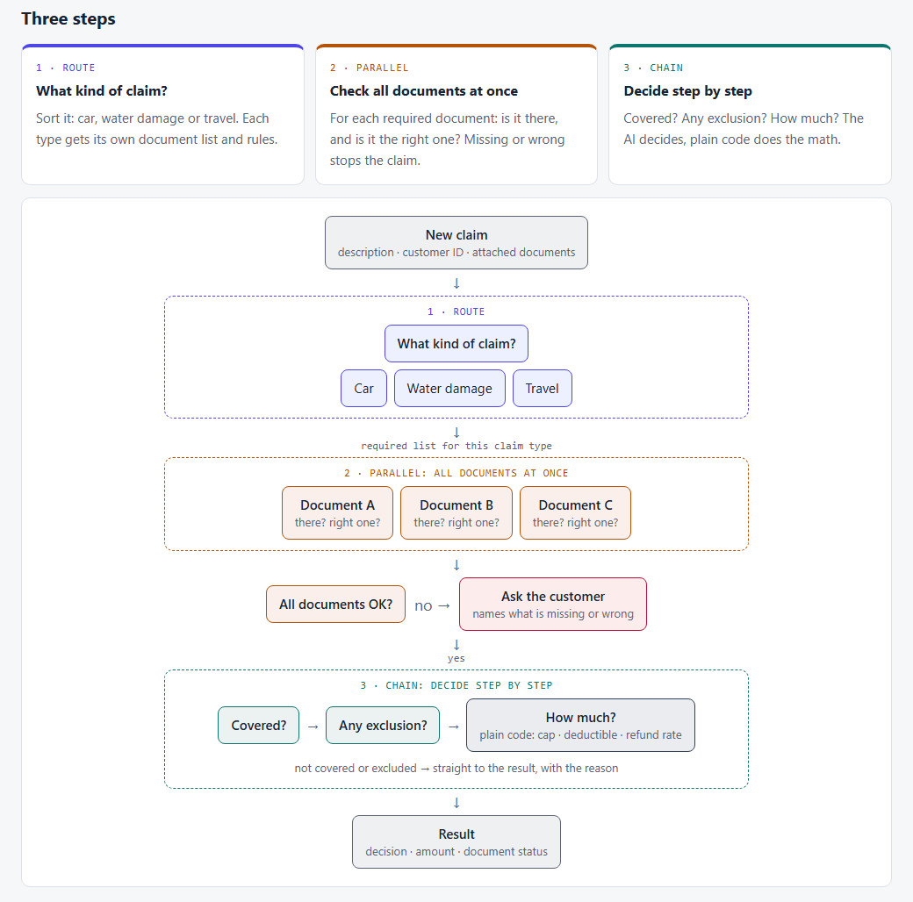

# 01 · One big prompt or a workflow?

## Why I did this

I came across Anthropic's cookbook series on building with LLMs. One of the first posts, [Basic Multi-LLM Workflows](https://platform.claude.com/cookbook/patterns-agents-basic-workflows), shows three patterns for splitting a job across several model calls: **route**, **parallel** and **chain**.

The post shows *how* to build them. It doesn't say *when* they are worth it. That made me curious. A single long prompt is simple, cheap and fast. A workflow gives you more control, but every extra call costs time and money, and is one more place to break.

So the question for this topic is:

> **When is one long prompt enough, and when does a more structured workflow pay off?**

## What I did

- **Simulated the data.** I wrote three short policy wordings for a made-up insurer, 21 customers with their policies, and two sets of 30 claims, each with its documents and a known right answer. The second set is harder, and I only used it at the end.
- **Built the full pipeline** in Python: an LLM router that decides the claim type, parallel document checks, and a step-by-step decision chain where plain code does the money math.
- **Ran every claim through five levels**, each one adding a step on top of the last, 3 times per level, and scored each answer against the key.

| Level | How a claim is handled | Calls per claim |
|---|---|---|
| **0** | One big prompt: all three policy wordings, the customer's policies, the claim and its documents. One answer. | 1 |
| **1** | **+ Route.** The model first decides the claim type, then a prompt with only that policy wording decides. | 2 |
| **2** | **+ Parallel.** Before deciding, one call per required document checks it, all at the same time. | about 5 |
| **3** | **+ Chain.** Covered? → any exclusion? → read the numbers. Code computes the amount. | about 6 |
| **0+** | Level 0 again, on a larger model. | 1 |

**How to read this table:** going down from level 0 to level 3 you add structure, one pattern at a time. If a pattern helps, accuracy should go up as you go down. If it doesn't, you pay more calls for nothing. Level 0+ asks a different question: is a smarter single call better than a workflow of cheaper calls?

Levels 0–3 use `gpt-6-luna` (a small, cheap model). Level 0+ uses `gpt-6.1-sol`. Prompt caching was on at every level.

## The business use case: insurance claims intake

I know insurance claims from the inside, so I picked that. A customer sends a claim: a short description, their customer ID and some attached documents. The system has to decide what happens next:

- **approve in full**, or **approve in part** (a cap, a private-provider rate, or part of the claim excluded)
- **decline**, with the reason (not covered, excluded, or no matching policy)
- **ask for documents**, naming exactly which one is missing or wrong
- **hand to a person**, when it can't tell what kind of claim it is

Three lines of business, all made up:

- **car comprehensive:** assessor's report, listed drivers, minimum driver age
- **home water damage:** water-damage add-on, slow leaks excluded, network vs private plumber
- **travel:** medical abroad, and trip cancellation

The workflow uses one pattern per step:



The full diagram, with what each claim type checks, is in [`design/process-diagram.html`](design/process-diagram.html).

## KPIs and success metrics

Every answer is compared to the answer key. For each level:

| Metric | What it means | Why it matters |
|---|---|---|
| **Decision right** | The decision matches the key (full / partial / decline / documents / person). | The main KPI. A wrong decision is a wrong outcome for the customer. |
| **Amount right** | The amount matches to the shekel. | Paying too much or too little is still a mistake. |
| **Doc problems caught** | When a document is really missing or wrong, the system asks for exactly that one. | Missing paperwork should stop a claim. |
| **False doc alarms** | The system asks for a document that was actually fine. | Each false alarm is an angry customer and a delay. |
| **Time per claim** | Wall-clock seconds from claim in to answer out. | Waiting time, and throughput. |
| **$ per 1,000 claims** | What the API calls cost. | Cost at volume. |
| **Calls per claim** | How many model calls one claim took. | More calls means more cost and more places to fail. |

**What I expected going in:** the workflow would be **more accurate**, especially on tricky claims, and would cost **more** and take **longer**. Success for the workflow meant a **clear win on decisions** at a cost I could justify. If it didn't beat one prompt, that's an answer too.

## What's in the folder

```
01-prompt-vs-workflow/
├── README.md           ← this page
├── results.md          ← full results tables, built from the run files
├── design/
│   ├── design.md       ← the design: question, use case, levels, decisions
│   ├── hard-set.md     ← what makes the hard set hard
│   ├── plan.md         ← the build plan, task by task
│   └── process-diagram.html / .png
├── claimsflow/         ← the code
├── data/
│   ├── policies/       ← the three policy wordings (markdown)
│   ├── customers.json  ← 21 customers and their policies
│   ├── claims.json     ← 30 claims with their documents
│   ├── answer_key.json ← the right answer for each claim
│   └── hard/           ← 30 held-out harder claims + their key
├── evals/              ← offline tests (no API calls)
└── runs/               ← raw run files (git-ignored)
```

**`claimsflow/`, one file per job:**

```
claimsflow/
├── models.py    ← the data shapes as dataclasses: Claim, Attachment, Policy, Customer, Figures, Result
├── data.py      ← loads policies, customers, claims and the answer key (main or hard set)
├── rules.py     ← fixed business rules in plain code: required documents per claim type,
│                  finding the customer's policy, compute_payout (rate, then cap, then deductible)
├── prompts.py   ← all prompt text: one place to read what each step is told
├── levels.py    ← levels 0–3: the router, the parallel document check (a thread pool,
│                  like the article's parallel()) and the chain; parses the XML-tag answers
├── score.py     ← compares answers with the key and computes the metrics
├── run.py       ← command-line runner: cost estimate first, stops over budget (default $10),
│                  runs the claims, saves a run file
└── report.py    ← builds results.md from the run files; nothing in it is typed by hand
```

The shared model helper is outside this folder, in [`shared/llm.py`](../../shared/llm.py): one `llm_call()` for OpenAI or Anthropic, plus time, tokens and cost tracking per call. The tests in `evals/` replace the model with a fake, and the root `conftest.py` blocks any real API call during tests.

## Results: the main set

30 claims × 3 repeats per level. I ran the workflow once, found two bugs in it, fixed them, and ran levels 1–3 again.

| Level | Decision right | Amount right | Doc problems caught | False doc alarms | Time / claim | $ per 1,000 claims |
|---|---|---|---|---|---|---|
| 0 (gpt-6-luna) | **100%** | 100% | 100% | 0% | 3.0 s | $0.11* |
| 1, first try | 76% | 89% | 72% | 0% | 3.6 s | $0.13 |
| 2, first try | 60% | 80% | 33% | 28% | 5.0 s | $0.39 |
| 3, first try | 59% | 81% | 33% | 31% | 6.2 s | $0.46 |
| 1, fixed | 99% | 99% | 100% | 0% | 4.2 s | $0.12 |
| 2, fixed | 96% | 97% | 72% | 0% | 5.9 s | $0.43 |
| 3, fixed | 94% | 97% | 78% | 0% | 7.8 s | $0.53 |
| 0+ (gpt-6.1-sol) | **100%** | 100% | 100% | 0% | 2.9 s | $1.50 |

\* Level 0's cost here is a little low: it ran right after an identical run, so most of its prompt was already cached. With normal caching it's about $0.14.

**What I found:**

- **One big prompt was right every time**, even on the small model. On these claims the workflow had nothing to fix.
- **The first try of the workflow was much worse (59–76%).** Both problems were in the glue between the steps, not in the patterns themselves:
  - The router often picked the right claim type but wrote it inside the wrong XML tag. My code read that as "unclear" and sent good claims to a person.
  - Each document checker sees one document alone, and I had told it the document must name the insured. Repair quotes and assessor's reports name the car or the address, not the person, so it asked for documents that were fine.
- **After the fixes the workflow got close (94–99%) but never beat one prompt.** It also made new mistakes. The "is it covered?" step was told "the event must be inside the policy period", which is wrong for trip cancellations (they're covered before the trip starts). One big prompt read the full wording and got those right.
- **My own document rule let a parent's letter pass as proof** of a child's illness (CAN-07). Every narrow rule is one more thing to get right.
- **The workflow cost about 4–5× more and took about 2.5× longer.**

I tuned the fixes on these same 30 claims, so the "fixed" rows are a best case. That's why I built a second set.

## Observations: the hard set

30 new claims that **no prompt was tuned on** ([`design/hard-set.md`](design/hard-set.md)):

- longer documents and extra attachments: last year's assessor's report, a car registration named "license", a friend's receipt
- sums over many lines with no total
- numbers that conflict between documents
- facts buried in long text: who really drove, a corroded pipe, an old illness, the date of a call-up
- routing traps: a car flooded in a parking garage is a car claim, and a home flood found after a holiday is not a travel claim

I reviewed the answer key before the run. After the run I made one ruling (the burst water heater itself isn't covered, H-WAT-01), and the scores were re-computed from the saved runs, not re-run.

| Level | Decision right | Amount right | Doc problems caught | False doc alarms | Time / claim | $ per 1,000 claims |
|---|---|---|---|---|---|---|
| 0 (gpt-6-luna) | **94%** | 93% | 89% | 4% | 3.5 s | $0.15 |
| 1 | **94%** | 94% | 89% | 6% | 5.4 s | $0.20 |
| 2 | 76% | 83% | 67% | 25% | 6.6 s | $0.55 |
| 3 | 70% | 80% | 67% | 30% | 7.7 s | $0.61 |
| 0+ (gpt-6.1-sol) | **96%** | 96% | 100% | 1% | 3.0 s | $1.76 |

**What this means:**

- **Now one prompt does fail, but only a little (94%).** Once it missed a call-up order dated before the trip was booked. And every time it asked for new receipts when one of them was a friend's. Every small-model level did that, because my own prompt says a document in another person's name is "wrong". That one can be read two ways.
- **Routing (level 1) didn't help or hurt.** It caught both routing traps. It just added a call.
- **The narrow document checks hurt most.** Each checker sees one document and takes the claim at its word:
  - a parked car "has no driver", so the driver's license is "wrong"
  - the amount claimed is the loss after refunds, so the receipts "don't match"
  - photos of an engine with no outside damage "show no damage"
- **The chain can't say "part of it".** The "any exclusion?" step answers yes or no for the whole claim, so one excluded visit after a trip declined the whole medical claim, every time. Even past that step, the math code could only have called it "full", never "partial because part is excluded".
- **The bigger single model was the most accurate and the fastest**, at about 11× the small model's cost and 3× the full workflow's. Its one repeated miss: it paid for the burst water heater itself, which the wording doesn't cover.

## When to use what

| Option | Use it when… | Skip it when… |
|---|---|---|
| **One big prompt** | Everything the model needs (rules, documents) fits in one prompt and it can read it all together. Here it was the most accurate on the small model, the cheapest and the fastest. | It starts missing things you can name and test. Then try a **bigger model** first: one change, and here still the fastest option. |
| **Route** | Each type needs very different rules, or the full rule set is too long for one prompt. Here it cost almost nothing extra. | Everything already fits in one prompt. It adds a call and doesn't add accuracy. If you use it, read its answer forgivingly. |
| **Parallel** | The checks are truly independent, and each one fits in one short, exact rule, or speed across many documents matters. | A check needs the rest of the claim to judge it. One document alone led to 25–30% false alarms on the hard set. |
| **Chain** | You need to show each step, or the math must be exact and auditable, so code does it. | A step's short instructions leave out a rule the full text has, a step has to answer yes/no where the real answer is "part of it", or the outcome is a case the code can't express. |

**The explanation behind it:** splitting a job doesn't make the model smarter. It makes each call see **less**. That helps when the full job is too big or too mixed for one prompt. It hurts when a step needs context it no longer has. And every split adds glue code (parsing, rules, hand-offs), which is where most of my mistakes were.

**My rule of thumb:** start with one prompt and a small test set with known answers. Split only the step you can **show** is failing, and measure again.

## Caveats

- **Made-up data:** 3 short policy wordings and 30 + 30 claims. Real policies and files are much longer and messier, and that's where routing and splitting should start to pay off.
- **One model family** (OpenAI), and 3 repeats per level.
- **The answer key is one person's reading** (mine). Two claims can be read two ways (the water heater, the friend's receipt).
- **Prompt caching was on everywhere**, which helps the long single prompt the most. Cache warmth also depends on run order, so the hard-set costs are the fairer ones.
- **Costs are tiny here** (under $2 per 1,000 claims at every level). The workflow's 4–5× cost and 2–2.5× time only matter at real volume.

## What I'd improve next time

- Ask the API for a **fixed answer format** (structured output) instead of reading XML tags.
- Let the document check **see the whole claim**, or check all documents in one call.
- Let the chain answer **"partial because part is excluded"**.
- Build the **hard set first**, before any tuning, and keep it hidden until the end.
- Try **longer, real-size policies**, where one prompt should start to struggle.
- Out of scope this time:
  - splitting a claim into damage parts (pipe, wall, cabinet)
  - sending a claim to an assessor or investigator
  - waiting for missing documents and checking again
  - searching a large policy library (RAG)

## How to run it

From the repo root (PowerShell), with `OPENAI_API_KEY` in `.env`:

```powershell
$env:PYTHONPATH = ".;topics/01-prompt-vs-workflow"
.venv\Scripts\python -m claimsflow.run --level 3 --dry-run               # cost estimate only
.venv\Scripts\python -m claimsflow.run --level 3 --repeats 3 --yes       # main set
.venv\Scripts\python -m claimsflow.run --level 3 --repeats 3 --yes --set hard
.venv\Scripts\python -m claimsflow.report                                # rebuild results.md
.venv\Scripts\python -m pytest -q                                        # offline tests
```
