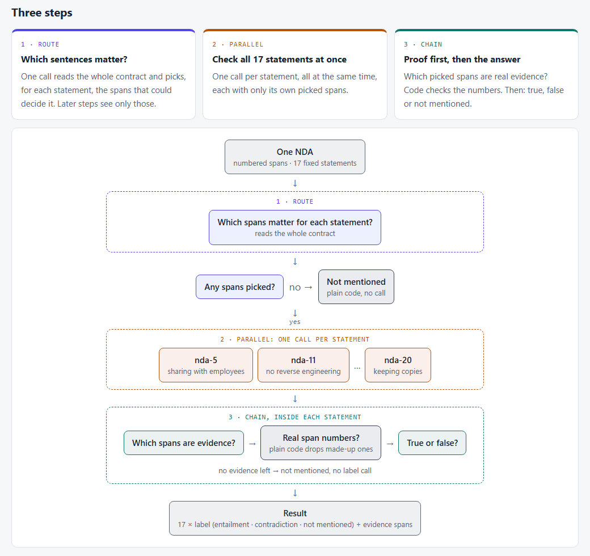

# 02 · One big prompt or a workflow, on real contracts

## Why I did this

<!-- NOTES for the author (rewrite in your own voice, then delete):
- Topic 1 asked: when is one long prompt enough, and when does a workflow (route → parallel → chain) pay off?
  On made-up insurance claims, one prompt won, and a bigger model beat splitting the job.
- Topic 1's own caveats: the data and the answer key were mine, and the documents were short.
- So this topic runs the same test on real data: real NDAs, with labels written by lawyers.
- The question: same test, real data: does the answer change?
-->

## Spoiler alert: the bottom line

Not run yet. This section is written from `results.md` after the full runs.

## What I did

- **Took real data.** 60 non-disclosure agreements (NDAs) from the public ContractNLI dataset: 30 to tune on, 30 held out until the end.
- **Kept the job from the dataset.** For each NDA, check 17 fixed statements ("the receiving party may share the information with its employees"). For each one: does the contract **say it** (entailment), **say the opposite** (contradiction), or **not mention it**, and which sentences prove it?
- **Rebuilt topic 1's five levels** on this job, so the two topics can be compared row by row:

| Level | What it adds | Calls per contract |
|---|---|---|
| **0** | One big prompt: the whole contract and all 17 statements, one answer | 1 |
| **1** | **Route** first: one call picks the sentences that matter for each statement; the answer prompt sees only those | 2 |
| **2** | **Parallel**: one call per statement, all at the same time | up to 18 |
| **3** | **Chain** inside each statement: find the evidence first (code checks the sentence numbers), then decide | up to 35 |
| **0+** | Level 0 again on a bigger model | 1 |

## The use case: reviewing NDAs

<!-- NOTES for the author:
- Why NDAs: the most common contract a company signs; a legal team checks the same points every time.
- The 17 statements are fixed (the dataset's "hypotheses"): sharing with employees, with third parties, return or destroy,
  survival after the end, no reverse engineering, no solicitation, keeping copies, and so on.
- The contract text comes already split into numbered spans (sentences or list items). Evidence = span numbers.
-->



**Data credit.** The contracts and labels come from **ContractNLI** (Koreeda & Manning, 2021, [stanfordnlp.github.io/contract-nli](https://stanfordnlp.github.io/contract-nli/)), released under **CC BY 4.0**. See [`data/NOTICE.md`](data/NOTICE.md) for what I took and changed.

## KPIs and success metrics

| Metric | What it means |
|---|---|
| **Label right** | Share of the 510 contract × statement pairs (30 × 17) with the right label |
| **F1 entailment** | How well it finds the "the contract says so" answers: catches them and doesn't invent them (0 to 1) |
| **F1 contradiction** | The same for "the contract says the opposite". Only about 1 pair in 10 is a contradiction, so this is the hard one |
| **Evidence found** | Of the sentences the lawyers marked as proof, the share the model named |
| **Evidence precision** | Of the sentences the model named, the share that really are proof |
| **Errors** | Answers my code could not read (counted as wrong) |
| **Seconds, $, calls per contract** | What each level costs to run |

<!-- NOTES for the author: what did you expect before the runs? (topic 1's result says one prompt; real, longer text says the workflow might catch up) -->

## What's in the folder

```
02-contract-nli/
├── README.md           ← this page
├── results.md          ← full results tables, built from the run files
├── design/
│   ├── design.md       ← the design: question, data, levels, decisions
│   ├── plan.md         ← the build plan, task by task
│   └── process-diagram.html / .png
├── ndaflow/            ← the code
├── data/
│   ├── main.json       ← 30 NDAs from the dataset's dev split, with their labels
│   ├── test.json       ← 30 held-out NDAs from the test split, with their labels
│   ├── statements.json ← the 17 statements
│   └── NOTICE.md       ← credit and licence (CC BY 4.0)
├── evals/              ← offline tests (no API calls)
└── runs/               ← raw run files (git-ignored)
```

**`ndaflow/`, one file per job:**

```
ndaflow/
├── models.py      ← the data shapes as dataclasses: Statement, Contract, Answer; the 17 statement ids
├── build_data.py  ← one-off: draws the 30 + 30 NDAs from the downloaded dataset (fixed seed) into data/
├── data.py        ← loads the statements, the contracts and the answer key (main or test set)
├── prompts.py     ← all prompt text: one place to read what each step is told
├── levels.py      ← levels 0–3: the router, the parallel per-statement checks (a thread pool,
│                    like the article's parallel()) and the chain; reads the XML-tag answers and
│                    drops sentence numbers that don't exist
├── score.py       ← compares answers with the key: label right, F1 per label, evidence found / precision
├── run.py         ← command-line runner: cost estimate first, stops over budget (default $10),
│                    runs the contracts, saves a run file
└── report.py      ← builds results.md from the run files; nothing in it is typed by hand
```

The shared model helper is outside this folder, in [`shared/llm.py`](../../shared/llm.py), the same one topic 1 uses.

## Results: the main set

Not run yet.

## Observations: the held-out test set

Not run yet.

## When to use what

<!-- Filled after the runs. Compare with topic 1's table: what held, what changed on real data? -->

## Caveats

<!-- NOTES for the author (check after the runs):
- 30 + 30 NDAs out of 607, 3 repeats per level, one model family (OpenAI).
- Contradiction is rare (~1 pair in 10), so its F1 moves a lot between runs.
- Every NDA still fits in one prompt (the longest is about 10k tokens). Routing here cuts context by choice, not by need.
- The labels are the dataset's; a few may be arguable, but they are not mine.
-->

## What I'd improve next time

<!-- Filled after the runs. -->

## How to run it

From the repo root (PowerShell), with `OPENAI_API_KEY` in `.env`:

```powershell
$env:PYTHONPATH = ".;topics/02-contract-nli"
.venv\Scripts\python -m ndaflow.run --level 3 --dry-run               # cost estimate only
.venv\Scripts\python -m ndaflow.run --level 3 --repeats 3 --yes       # main set
.venv\Scripts\python -m ndaflow.run --level 3 --repeats 3 --yes --set test
.venv\Scripts\python -m ndaflow.report                                # rebuild results.md
.venv\Scripts\python -m pytest -q                                     # offline tests
```

To rebuild `data/` from the original dataset: download and unzip
[contract-nli.zip](https://stanfordnlp.github.io/contract-nli/resources/contract-nli.zip), then
`.venv\Scripts\python -m ndaflow.build_data <path to the contract-nli folder>`.
