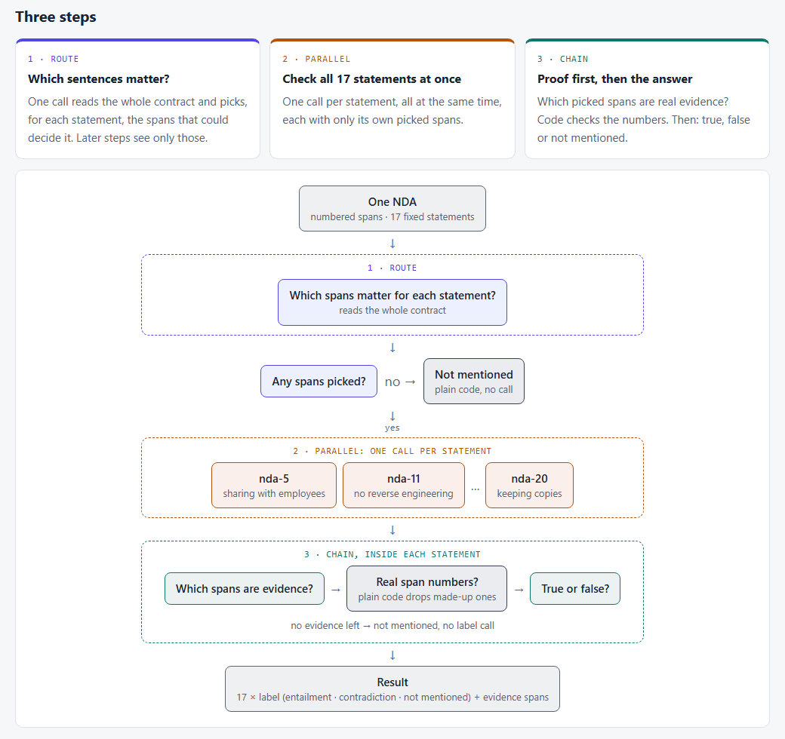

# 02 · One big prompt or a workflow? Part 2: real contracts

## How this started

In [topic 01](../01-prompt-vs-workflow-claimsflow/) I tested Anthropic's post [Basic Multi-LLM Workflows](https://platform.claude.com/cookbook/patterns-agents-basic-workflows) on made-up insurance claims. One big prompt beat the workflow (route → parallel → chain), and a bigger model beat splitting the job.

But that result had a weak spot, and I knew it: **I wrote both the claims and the right answers.** And the documents were short.

So I wondered: would the answer change on real documents, with answers someone else wrote? I tried to find out.

## What Anthropic claims, and what it implies

The post shows three ways to split one job across several model calls, each with one small example: **chain** (turn a summary into a table in four steps), **parallel** (four stakeholder analyses at the same time), and **route** (sort support tickets to the right team's prompt).

The claim is in one line: these workflows **"trade off cost or latency for potentially improved task performances."**

What it implies: **pay a bit more in calls and time, and you get a better answer.**

The post calls its code **"sample implementations meant to demonstrate core concepts - not production code."** Nothing is measured.

Topic 01 said the claim didn't hold on my data. This topic asks whether it holds on **real** data.

## My experiment

So I decided to take it a step further and run the same experiment on real contracts.

### The question

**Same test, real data: on real NDAs with lawyer-written labels, does one big prompt still beat the workflow? And does a bigger model still fix what one prompt misses?**

### The data

[ContractNLI](https://stanfordnlp.github.io/contract-nli/) from Stanford is just what I needed: real non-disclosure agreements (NDAs), each checked by lawyers against **17 fixed statements** ("the receiving party may share the information with its employees", "no reverse engineering", "copies must be returned or destroyed", and so on).

For each contract and each statement, the job is: does the contract **say it**, **say the opposite**, or **not mention it**, and which sentences prove it? Every contract is already split into numbered sentences, so the proof is a list of numbers my code can check.

- **Main set**, 30 NDAs from the dataset's dev split. I was allowed to tune on this one.
- **Held-out set**, 30 NDAs from its test split. No prompt changed once this run started.

That's 510 contract × statement pairs per set.

### The process

I rebuilt topic 01's five levels on this job, so the two topics can be compared row by row:

- **Level 0 · one big prompt.** The whole contract and all 17 statements, one answer. 1 call.
- **Level 1 · + route.** One call picks the sentences that matter for each statement. The answer prompt sees only those. 2 calls.
- **Level 2 · + parallel.** One call per statement, all at the same time. Up to 18 calls.
- **Level 3 · + chain.** Inside each statement: find the proof first (code checks the sentence numbers), then decide. Up to 35 calls.
- **Level 0+ · one big prompt on a bigger model.**

Levels 0–3 use `gpt-6-luna` (small and cheap). Level 0+ uses `gpt-6.1-sol`. Prompt caching was on everywhere. Each level ran 3 times.



## How I measure it

| What I measure | In plain words |
|---|---|
| ✅ **Label right** | Share of the 510 pairs where the label matches the lawyers' |
| 🟢 **F1 "says it"** | How well it finds "the contract says so" answers without inventing them (0 to 1) |
| 🔴 **F1 "says the opposite"** | The same for contradictions. Only about 1 pair in 10, so the hard one |
| 🔍 **Proof found** | Of the sentences the lawyers marked as proof, how many the model named |
| 🎯 **Proof precision** | Of the sentences the model named, how many really are proof |
| ⏱️💰 **Time and cost** | Seconds and dollars per contract |

**What Anthropic's post suggests:** more calls **may** give a better answer.

**What I expected** (my guesses before running anything):

- Topic 01 said one prompt wins, but **real, longer contracts might let the workflow catch up**, because each step gets a smaller, cleaner piece of text.
- The **bigger model would win again**, like it did on the hard claims.

## The results

Full tables in [`results.md`](results.md).

### The main set

30 NDAs × 17 statements × 3 repeats.

| Level | Label right | F1 says it | F1 opposite | Proof found | Proof precision | Time / contract | $ / contract |
|---|---|---|---|---|---|---|---|
| 0 · one prompt | **83%** | 0.86 | 0.59 | 56% | 72% | 21 s | $0.0013 |
| 1 · route | 82% | 0.86 | 0.58 | 62% | 67% | 42 s | $0.0019 |
| 2 · + parallel | 78% | 0.82 | 0.57 | 54% | 72% | 23 s | $0.0024 |
| 3 · + chain | 78% | 0.82 | 0.55 | 59% | 63% | 28 s | $0.0031 |
| 0+ · bigger model | 80% | **0.87** | 0.56 | **72%** | 59% | **9 s** | $0.0090 |

- **The glue broke again, twice** (see the lessons below). Both were fixed before the held-out run; the table shows the re-run.
- **With the glue fixed, the workflow still came in about 5 points under one prompt.** The errors were never the main gap.
- **The bigger model was the fastest and found the most proof, but not the most right labels.** That was new.

### The held-out set

30 different NDAs. **No prompt changed after this run started.**

| Level | Label right | F1 says it | F1 opposite | Proof found | Proof precision | Time / contract | $ / contract |
|---|---|---|---|---|---|---|---|
| 0 · one prompt | **82%** | 0.86 | **0.63** | 61% | **73%** | 21 s | $0.0013 |
| 1 · route | 81% | 0.85 | 0.62 | 65% | 66% | 41 s | $0.0019 |
| 2 · + parallel | 77% | 0.80 | 0.62 | 55% | 69% | 21 s | $0.0024 |
| 3 · + chain | 76% | 0.79 | 0.59 | 59% | 58% | 26 s | $0.0032 |
| 0+ · bigger model | 81% | **0.88** | 0.61 | **76%** | 58% | **9 s** | $0.0091 |

- **Within 1–2 points of the main set**, same ranking. The fixes didn't over-fit.
- **The workflow's typical miss is "not mentioned" where the contract does say it.** One prompt did that about 1 time in 8. Levels 2 and 3 did it about 1 time in 5. A step that sees only the router's picks can't find a clause the router missed.
- **The bigger model has the opposite problem.** It almost never misses what the contract says (5% against 13%), but where the lawyers said "not mentioned" it answered "says it" or "says the opposite" about 1 time in 3. Its weakest statements were "all confidential information must be expressly identified" and "copies may be made" (both 41% right).
- **"Says the opposite" stays hard for everyone** (F1 0.59–0.63). It's rare and often hides in an exception to a clause.
- **The hardest statement for the small model was "no licensing"** (48–57% right). It's usually implied, not written out.

## Key takeaways

- **Same test, real data: the answer didn't change.** One big prompt was still the most accurate on the small model, and the cheapest.
- **Splitting a job makes each call see less.** On real contracts the miss shows up in one place: a clause the router didn't pick is a clause the next step can never find.
- **The glue broke again.** Two format bugs, the same lesson as topic 01: most of the mistakes live in the hand-offs.
- **The bigger model is no longer the easy fix.** It found more proof and over-read. A bigger model is a change to measure, not an upgrade to assume.
- **Routing became nearly free in accuracy and found more proof** (65% vs 61%), but it doubled the wait, because its two calls run one after the other.

| Option | Topic 01 (made-up claims) | Topic 02 (real NDAs) | So… |
|---|---|---|---|
| **One big prompt** | Best on the small model | **Still best** on labels, cheapest | Start here. Every NDA fit in one prompt |
| **Route** | Free, didn't help | Nearly free, **found more proof**, **2× slower** | Use it for the proof list, or when documents don't fit |
| **Parallel** | Hurt: each check saw too little | Hurt: each check saw only the router's picks | Only for checks that truly stand alone |
| **Chain** | Hurt: steps lost the full picture | Hurt the most on labels | Use it for auditability, not accuracy |
| **Bigger model** | Best on hard claims | **Best at finding proof**, fastest, but **over-reads** | Measure it before you switch |

## Limitations

- **Small sample:** 30 + 30 NDAs out of 607, 3 repeats per level, one model family (OpenAI).
- **Contradiction is rare** (about 1 pair in 10), so its F1 moves a few points between runs.
- **Every NDA still fit in one prompt** (the longest is about 10K tokens). Routing cut the text by choice, not by need. With contracts too long for one prompt, the picture could change.
- **The labels are the dataset's, not mine.** A few look arguable (like "no licensing"), so part of the bigger model's "over-reading" may be fair reading.
- **The two glue fixes were tuned on the main set.** The held-out set had at most 1 unreadable answer per repeat.

**Data credit.** The contracts and labels come from **ContractNLI** (Koreeda & Manning, 2021, [stanfordnlp.github.io/contract-nli](https://stanfordnlp.github.io/contract-nli/)), released under **CC BY 4.0**. See [`data/NOTICE.md`](data/NOTICE.md) for what I took and changed.

## Technical walkthrough

### The data

- **Source:** the ContractNLI release ([contract-nli.zip](https://stanfordnlp.github.io/contract-nli/resources/contract-nli.zip)).
- **How I drew the sets:** `build_data.py` draws 30 NDAs from the dev split and 30 from the test split with a fixed seed, and keeps each statement's label and proof sentence numbers as the dataset has them.
- **Files:** [`data/main.json`](data/main.json), [`data/test.json`](data/test.json), [`data/statements.json`](data/statements.json) (the 17 statements).

### The tools

| Tool | What I used it for |
|---|---|
| **Python 3** | Everything |
| **OpenAI API**, `gpt-6-luna` and `gpt-6.1-sol` | The model calls, through the same shared helper as topic 01 ([`shared/llm.py`](../../shared/llm.py)) |
| **A thread pool** | The parallel level, like the cookbook's `parallel()` |
| **pytest** | Offline tests; a shared fixture blocks every real API call during tests |
| **Claude Code** | My pair programmer: design, plan, code and review |

### The process, step by step

1. `build_data.py` (one-off) draws the 30 + 30 NDAs from the downloaded dataset into `data/`.
2. `data.py` loads the statements, the contracts and the answer key (main or test set).
3. `prompts.py` holds all the prompt text.
4. `levels.py` runs levels 0–3: the router, the parallel per-statement checks and the chain. It reads the XML-tag answers and drops sentence numbers that don't exist.
5. `score.py` computes label right, F1 per label, and proof found / precision.
6. `run.py` prints a cost estimate first, stops over budget (default $10), and saves every run as a file.
7. `report.py` builds [`results.md`](results.md) **from the run files only**. No number is typed by hand.

### The evals

Offline tests, no API calls, no cost. They pin down the things that would quietly skew the numbers:

- **The sets are sound:** 30 contracts each, no overlap, and every key covers all 17 statements with valid proof numbers.
- **Reading the answers:** spelling variants of a label still read, other words are rejected, and an unreadable label is an **error**, never a silent "not mentioned".
- **Made-up proof is dropped:** a sentence number that isn't in the contract (or outside the router's picks) never counts as found.
- **Each level does what it says:** level 1's answer step sees only the picked sentences, level 2 makes one call per routed statement, level 3's label step sees only the proof.
- **Scoring:** checked against scores counted by hand, and no contradictions gives F1 0, not a crash.

### Lessons from building it

Two format bugs, and neither crashed anything:

- **A label in the wrong tag.** The chain's last step wrote `<contradiction>` instead of `<label>contradiction</label>`. A 2-contract smoke test caught it: 29 of 34 answers were unreadable. Fixed before the full run.
- **A sentence number in a closing tag.** The router sometimes wrote `<nda-7>11</nda-11>`, which made 1–3% of answers at levels 1–3 unreadable. I found it by calling the router 48 times on the failing contracts (8 had the slip), fixed it, and re-ran levels 1–3.

Next time I'd **save the raw text of every answer my code can't read** (both bugs took extra calls to diagnose), and ask for a **fixed answer format** (structured output) instead of XML tags. That would likely have prevented all three format bugs across topics 01 and 02.

<details>
<summary><b>The folder and how to run it</b></summary>

```
02-prompt-vs-workflow-contract-nli/
├── README.md           ← this page
├── results.md          ← full results tables, built from the run files
├── design/             ← design.md, plan.md, process-diagram.html / .png
├── ndaflow/            ← the code
│   ├── models.py       ← Statement, Contract, Answer; the 17 statement ids
│   ├── build_data.py   ← draws the 30 + 30 NDAs (fixed seed)
│   ├── data.py         ← loads statements, contracts and the answer key
│   ├── prompts.py      ← all prompt text
│   ├── levels.py       ← levels 0–3
│   ├── score.py        ← label right, F1 per label, proof found / precision
│   ├── run.py          ← runner: cost estimate first, budget stop
│   └── report.py       ← builds results.md from the run files
├── data/               ← main.json, test.json, statements.json, NOTICE.md
├── evals/              ← offline tests (no API calls)
└── runs/               ← raw run files (git-ignored)
```

From the repo root (PowerShell), with `OPENAI_API_KEY` in `.env`:

```powershell
$env:PYTHONPATH = ".;topics/02-prompt-vs-workflow-contract-nli"
.venv\Scripts\python -m ndaflow.run --level 3 --dry-run               # cost estimate only
.venv\Scripts\python -m ndaflow.run --level 3 --repeats 3 --yes       # main set
.venv\Scripts\python -m ndaflow.run --level 3 --repeats 3 --yes --set test
.venv\Scripts\python -m ndaflow.report                                # rebuild results.md
.venv\Scripts\python -m pytest -q                                     # offline tests
```

To rebuild `data/`: download and unzip the dataset, then `.venv\Scripts\python -m ndaflow.build_data <path to the contract-nli folder>`.

</details>
