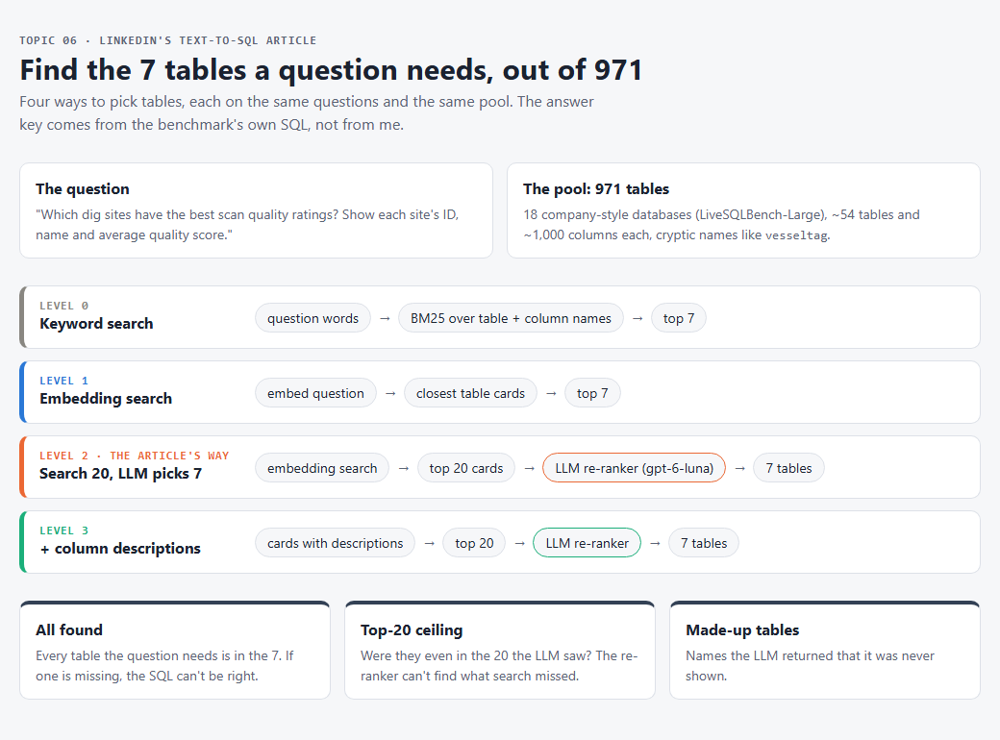

# 06 · Can an AI find the right tables in a big database?

## How this started

So, I came across this article from LinkedIn's engineering blog: [Practical text-to-SQL for data analytics](https://www.linkedin.com/blog/engineering/ai/practical-text-to-sql-for-data-analytics). It's about SQL Bot, the tool they built so people at LinkedIn can ask a data question in plain English and get a SQL query back.

The part that caught me wasn't the SQL. It was this: their warehouse has millions of tables, and the hard part is finding the right ones. If the bot picks the wrong tables, it doesn't matter how good the SQL is.

Then I found [the same idea at Pinterest](https://medium.com/pinterest-engineering/how-we-built-text-to-sql-at-pinterest-30bad30dabff). Two big companies, the same pattern. So I wanted to know: does it actually work, and how well?

Neither article really says. So I tried to find out.

## What LinkedIn and Pinterest claim, and what it implies

LinkedIn's table finding works in three steps:

1. **Search.** Turn the question and every table into embeddings, and take the **20** closest tables.
2. **An LLM picks.** Show those 20 to a model and let it choose the **7** a query needs.
3. **Write SQL** with only those 7.

They also say two things make the search better: **descriptions** of tables and columns, and **example queries**. Their graph (Figure 6) shows table recall going up as each piece is added. But it has no numbers on it. Their test set is about 130 private questions, and they don't say which models they use.

Pinterest does the same search-then-pick, with one twist: before anything else, an **LLM writes a short summary of every table**, and the search runs on those summaries. They say their table search hit rate was 40% before they added table documentation to the search. It got better as they gave the documentation more weight, but they don't give the final number.

What it implies: **you can point an LLM at a huge warehouse, and with a search step in front of it, it will find the tables your question needs.**

## My experiment

So I decided to take it a step further.

### The question

**When a warehouse has hundreds of tables, does "search 20, let an LLM pick 7" find every table a question needs? And do descriptions or LLM summaries help?**

### The data

I needed three things: a big, messy schema, real questions, and an answer key I didn't write.

- **The tables:** [LiveSQLBench-Large](https://huggingface.co/datasets/birdsql/livesqlbench-large-v1), from the BIRD team. 18 company-style databases, **971 tables** in all, about 1,000 columns per database. The names are messy on purpose: in the archaeology database, `vesseltag` is the project name and `fundflux` is where the money came from. Every column also has a one-line description written by the BIRD team.
- **The questions:** 332 analyst questions that come with the benchmark.
- **The answer key:** the BIRD team wrote a correct SQL query for each question. Snowflake's [SQL-Schema-Retrieval](https://huggingface.co/datasets/Snowflake/SQL-Schema-Retrieval) release parsed those queries into "this question needs these tables". I use that list. I never see the SQL itself.

I put all 971 tables in one pool, like one big warehouse. Every question searches all of them.

**Two sets.** I split the 18 databases in half with a fixed seed:

- **Main set:** 173 questions from 9 databases. I was allowed to look at these and adjust things.
- **Held-out set:** 159 questions from the other 9. New databases, new topics, never used for tuning.

The held-out questions turned out harder: they need 3.1 tables on average, against 2.3 in the main set. So I compare levels within a set, not one set against the other.

### The process

Every level hands **7 tables** to the (imagined) SQL writer, except levels 4 and 4c, which hand over 10.

- **Level 0 · Keyword search.** Match the question's words against table and column names. Free.
- **Level 1 · Embedding search.** Take the 7 closest tables by embedding.
- **Level 2 · LinkedIn's way.** Embedding search for 20, then an LLM picks 7.
- **Level 3 · + descriptions.** Same, but every table card also carries its column descriptions.
- **Level 4 · + joined tables.** Level 3's 7 picks plus 3 tables connected to them by a foreign key. This is my own add-on, in the spirit of LinkedIn's "common joins".
- **Level 4c · the control for level 4.** Level 3's 7 picks plus the next 3 from search. Also 10 tables, so if level 4 wins, it's the joins, not just "more tables".
- **Level 5 · Pinterest's way.** An LLM first writes a summary of each table from the same descriptions, using Pinterest's own prompt. Search and pick then use the summaries.

## How I measure it

- **All found.** Out of all questions, how many got **every** table they need. This is the one that matters: if one table is missing, the SQL can't be right.
- **Recall.** What share of the needed tables were found. Kinder than "all found", but it hides the missing piece.
- **Top-20 ceiling.** Were all the needed tables at least in the 20 the LLM was shown? The LLM can't pick a table the search never brought.
- **Made-up tables.** Answers where the LLM named a table it wasn't shown.
- **Cost and time** per question.

**What the articles suggest:** each step helps. The LLM pick beats plain search, descriptions help, and summaries help a lot.

**What I expect:** honestly, I didn't have a guess. So Claude wrote down its guesses before any paid run (held-out set, all found): embedding search about 15%, LLM pick about 30%, with descriptions about 40%. Its bet was that the top-20 ceiling would be the bottleneck, because tables that are only there for a join don't look like the question.

<!-- RESULTS -->
