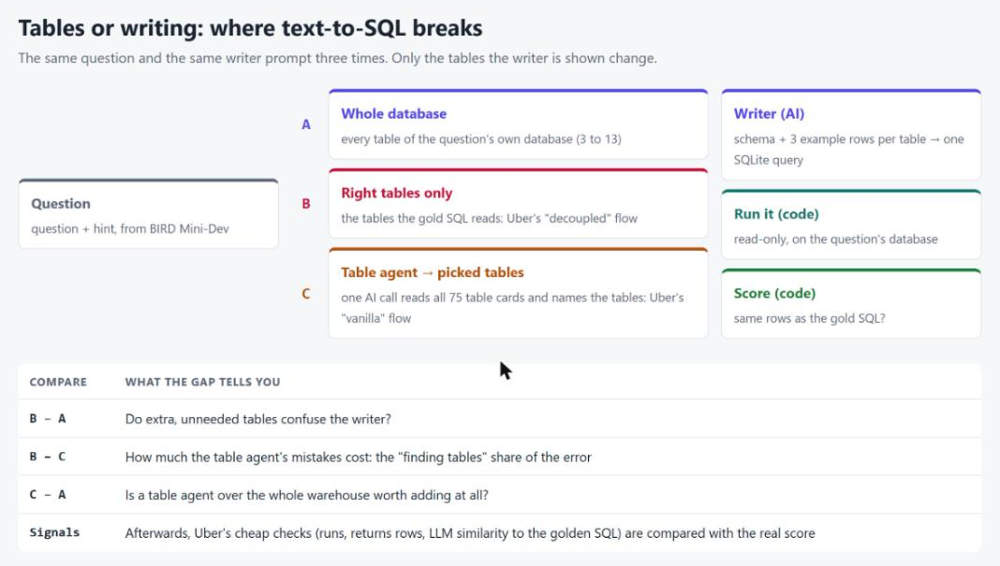
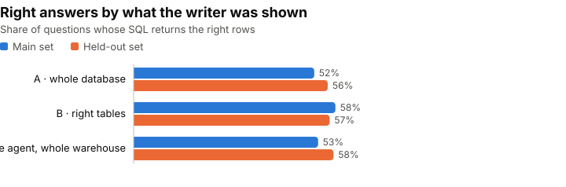
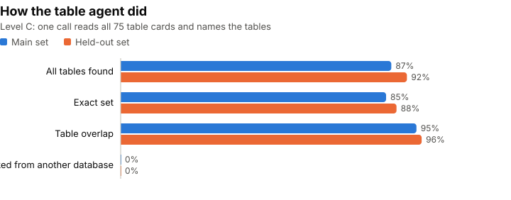
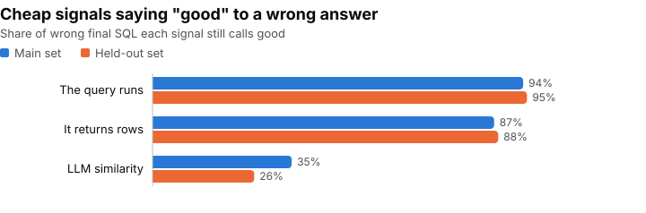

# 07 · Text-to-SQL: is the hard part finding the tables, or writing the query?

Three companies wrote up their text-to-SQL systems this year, and they agree on one thing. [Uber's QueryGPT](https://www.uber.com/lb/en/blog/query-gpt/), LinkedIn and Pinterest all spend most of their effort on **picking the right tables** before any SQL is written. The quiet claim behind that: the model can write SQL fine, it just gets lost in a big warehouse.

Uber even describes the test that would prove it. They score their system two ways: once finding the tables itself, and once **handed the right tables**. The gap between the two is what table search costs. They never print the numbers.

So I ran that test, on questions where the right answer is known.

## Uber's two flows

QueryGPT is a chain of small agents: an **intent agent** picks a business area, a **table agent** proposes tables (the user can fix them), a **column-prune agent** trims wide tables, and then the query is written.

To evaluate it, Uber keeps a set of questions with a "golden" query each, and runs two flows:

- **Vanilla:** the system finds the tables and writes the query. This is the real product.
- **Decoupled:** the system is **given the right tables** and only writes. A stand-in for a person fixing the tables first.

Per question they log: did the intent match, how many of the right tables were picked (**table overlap**), did the query **run**, did it **return rows**, and an **LLM score** of how similar it is to the golden query.

Two things in there are worth checking:

1. **Vanilla vs decoupled** splits the error in two: tables vs writing. Uber describes the split but doesn't report it.
2. **None of the logged signals is "the answer is right".** Runs, has rows and LLM similarity are cheap stand-ins. How good are they?

## What I expected

I wrote this down before any run:

- Giving the writer only the right tables helps **a few points**. BIRD databases are small (3–13 tables), so there's not much to get lost in.
- A table agent over the whole warehouse finds every right table **85–90%** of the time, and ends up **close to the plain baseline**.
- So on this scale, most of the error is **writing**, not finding tables.
- "Runs" and "returns rows" say **good to most wrong answers**. The LLM score does better, but still passes a fair share of them.

## The setup

**Questions.** The same 60 + 60 questions as [topic 05](../05-evaluator-optimizer-text-to-sql/), from [BIRD](https://bird-bench.github.io/) Mini-Dev: real SQLite databases (schools, Formula 1, a bank, hospital lab tests, football and more), each question with a hint and a correct query written by the dataset's authors. The **main set** (6 databases) is where I looked and set things; the **held-out set** (5 other databases) ran once at the end with nothing changed.

**One warehouse.** I put **all 75 tables** of the 11 databases in one list (798 columns), each named `database.table`. That's the haystack for the table agent.

**The right tables.** For each question, the tables its correct query **reads**. I didn't parse SQL for this: SQLite reports every table a query touches while it prepares it (an "authorizer" hook), so the list is exact.

**Three levels.** The writer prompt is the same every time (topic 05's). Only the tables it is shown change:

| Level | The writer is shown | Uber's name | AI calls |
|---|---|---|---|
| **A · whole database** | every table of the question's own database | (BIRD's usual setup) | 1 |
| **B · right tables** | only the tables the correct query reads | decoupled | 1 |
| **C · table agent** | the tables an agent picked from all 75 | vanilla | 2 |

For each table the writer gets its `CREATE TABLE` and 3 example rows. The table agent gets a one-line card per table: name, columns and types.



**Right** means the query returns the same rows as the correct query (BIRD's rule). Model: `gpt-6-luna` for the writer, the agent and the similarity judge. 3 repeats per level.

**The gaps:**

- **B − A:** do extra tables confuse the writer?
- **B − C:** what the table agent's mistakes cost.
- **C − A:** is a table agent over the whole warehouse worth adding?

## What came out

Full tables: [`results.md`](results.md). All numbers below come from the run files.



| Level | Right, main | Right, held-out |
|---|---|---|
| A · whole database | 52% | 56% |
| B · right tables | 58% | 57% |
| C · table agent | 53% | 58% |

| Gap | Main | Held-out |
|---|---|---|
| B − A (extra tables) | +6 | +1 |
| B − C (agent's mistakes) | +5 | −1 |
| C − A (agent worth it?) | +1 | +2 |

### Handing the writer the right tables barely helped

On the main set, level B looked like a real win: **+6 points** over the whole database. On the held-out set it was **+1**. With one question worth about 1.7 points and repeats of the same level moving by up to 7 points, I can't call either a clear effect. Even with the right tables in hand, the writer was **wrong on 42–43% of questions**.

### The table agent was good at its job



Reading all 75 cards in one call, the agent picked every right table in **87%** (main) and **92%** (held-out) of the questions, the exact set in 85% and 88%. It **never picked a table from the wrong database** and never made up a name. That matches what I expected.

When it did miss a table, the answer was almost always wrong: **12%** right on main, **0%** on held-out. So a miss costs a lot, but it was rare.

And level C ended up **level with A and B** on both sets. On this warehouse, the extra step neither paid off nor hurt; it only added a call: **8.0 vs 4.9 seconds** per question on main, and about 60% more cost (still a fraction of a cent).

### Most wrong answers had every table they needed

This is the real answer to the question. Counting level C's wrong answers over all repeats:

| | Main | Held-out |
|---|---|---|
| Wrong answers | 84 | 76 |
| …with every right table picked | 63 (**75%**) | 61 (**80%**) |
| …with a table missing | 21 | 15 |

**Three out of four wrong answers were writing mistakes**, not search mistakes. And **20–21 questions per set were wrong at every level in every repeat**: tables didn't matter for them at all.

Two misses on the main set show why "the right tables" is fuzzy. For a Formula 1 question about drivers "and the lap number", the agent picked `lapTimes`; the correct query gets it from `results`. For "the patient with the highest hemoglobin at the time of the examination", it added `Examination`, the writer used it, and the answer went wrong. Both picks are what a person might do from the question.

### "It runs" and "it returns rows" say yes to almost everything



| Signal | Says "good" to a wrong answer (main / held-out) | Says "good" to a right answer |
|---|---|---|
| The query runs | 94% / 95% | 100% / 100% |
| It returns rows | 87% / 88% | 100% / 100% |
| LLM similarity ≥ 0.9 | 35% / 26% | 89% / 88% |

The two cheap checks are **almost useless as a quality measure**: nearly every wrong query runs and returns rows. They only catch broken SQL.

The LLM similarity score does much better. The threshold (0.9) was picked on the main set and kept for the held-out set, where it still **flagged three out of four wrong answers** and kept 88% of right ones. But it still called **60 wrong answers out of 233** on the held-out set "the same as the golden query". It's a useful filter, not a replacement for running the query and comparing rows.

### What I expected vs. what happened

| I expected | What happened |
|---|---|
| B beats A by a few points | +6 on main, **+1 on held-out**: not a clear effect |
| The agent finds all tables 85–90% of the time | **87% / 92%** ✓ |
| C lands close to A | **+1 / +2** ✓ |
| Most of the error is writing | **75–80%** of wrong answers had every table ✓ |
| "Runs" / "has rows" pass most wrong answers | **87–95%** ✓ |
| LLM similarity does better, still passes a fair share | **26–35%** ✓ |

## So, is it the tables?

- **Not at this size.** On 75 tables across 11 clearly different databases, one AI call finds the right tables about 9 times in 10. What's left is mostly the writer getting the SQL wrong with the right tables in front of it.
- **Uber's split is the right tool.** Running "given the right tables" next to "find them yourself" took one extra level and answered the question directly. Any team building this can run it on their own warehouse.
- **Don't measure with "it runs".** If your eval logs only "runs" and "has rows", most wrong answers look fine. Keep a set of questions with known answers and compare rows.
- **An LLM similarity score is a decent cheap filter**, but set its threshold on data with known answers, and don't trust it alone.
- **The companies may still be right**, about their scale. With thousands of look-alike tables, search surely gets harder. This test says: measure that before assuming it.

## Limitations

- **75 tables is not Uber's warehouse.** Uber, LinkedIn and Pinterest talk about many thousands of tables. Here the 11 databases are on very different topics, so the right area is easy to spot. Table search is surely harder at their size; this test can't say how much harder.
- **The names help.** Every table carries its database (`formula_1.races`). A real warehouse has naming like that too, but cleaner names make the agent's job easier.
- **The right set of tables isn't always unique.** In one smoke question about charter school funding, the agent picked `schools` instead of `frpm`. Both tables have a funding-type column, so its query could have worked. It still counts as "missing" a table. Table overlap is a strict measure.
- **One model, low effort.** Writer, agent and judge are all `gpt-6-luna`, like the rest of this series. A stronger writer might shift the balance toward tables.
- **60 questions per set.** One question is about 1.7 points. Gaps of 1–2 points are noise.
- **No column pruning, no intent agent.** I left them out on purpose: the question is tables vs writing.

**Data credit.** Questions, hints, correct queries and databases come from **BIRD Mini-Dev** (the BIRD-SQL team), CC BY-SA 4.0. The table lists in `data/gold_tables.json` are derived from it; see [`data/NOTICE.md`](data/NOTICE.md).

## How it's built

### The parts

| File | What it does |
|---|---|
| `gold_tables.py` | Prepares each correct query in SQLite with an authorizer hook and records every table it reads (`data/gold_tables.json`) |
| `warehouse.py` | Loads all 75 tables, renders the agent's one-line cards and the writer's schema blocks |
| `agent.py` | The table agent: one call over all cards, returns `<tables>`; reads names case-free, drops made-up ones and counts them |
| `levels.py` | Levels A, B, C: decide which tables the writer sees, then call topic 05's writer |
| `score.py` | Right, runs, returns rows; for C also overlap, all found, exact, extra, wrong database |
| `judge.py` | Uber's LLM similarity, 0 to 1, run after the levels on stored SQL; each distinct query judged once |
| `signals.py` | Picks the similarity threshold on the main set and compares each signal with the real score |
| `run.py` | Cost estimate first, budget stop per command, $10 ceiling for the topic |
| `report.py`, `charts.py` | Build `results.md` and the charts from the run files only |

The writer, its prompt, the SQL runner (read-only, 10 s limit) and the row comparison are **topic 05's code, imported, not copied**, so level A here is the same thing as topic 05's level 0.

### The tests

38 offline tests (no API calls), on small SQLite databases made inside the tests:

- **Right tables:** the authorizer finds both tables of a join and tables inside subqueries, keeps SQLite's own spelling, and never runs the query. All 120 real correct queries get a list.
- **The agent's answer:** odd spelling (quotes, brackets, case) is read, duplicates are dropped, a made-up name is counted, not guessed.
- **Levels:** A shows exactly what topic 05's level 0 showed, B only the right tables, C only what the agent picked, from any database. If the agent's call fails, the writer is never called.
- **Scoring:** overlap and "all found" counted by hand on made-up runs; a table from another database is counted; an API outage is counted, not scored wrong.
- **Signals:** the threshold picks the best match on main, ties go to the higher one, unreadable judge scores are left out; each distinct query is judged once.
- **Money:** a dry run makes no calls; a run over budget or over the topic ceiling (judge files included) is refused.

### What I learned building it

- **Prompt caching did real work.** The agent reads the same ~75 cards on every call, so I put them first, as a fixed system message. OpenAI caches that part automatically, and level C cost less than my estimate.
- **Look at the "wrong" picks.** The smoke run's one missed table (the charter-funding question) wasn't a bad pick. That became a limitation instead of a bug fix.

<details>
<summary><b>The folder and how to run it</b></summary>

```
07-text-to-sql-where-it-breaks/
├── README.md        ← this page
├── results.md       ← full results, built from the run files
├── charts/          ← SVG charts, built from the run files
├── design/          ← design.md, plan.md, process-diagram.html / .png
├── sqlblame/        ← the code (see the table above)
├── data/            ← gold_tables.json, NOTICE.md (questions and databases come from topic 05)
├── evals/           ← offline tests
└── runs/            ← raw run files (git-ignored)
```

From the repo root (bash), with `OPENAI_API_KEY` in `.env` and topic 05's `data/raw/` in place:

```bash
export PYTHONPATH=".;topics/05-evaluator-optimizer-text-to-sql;topics/07-text-to-sql-where-it-breaks;topics/04-agent-security-review-agentdojo"
python -m sqlblame.gold_tables                              # right tables per question
python -m sqlblame.run --level C --set main --dry-run       # cost estimate only
python -m sqlblame.run --level C --set main --repeats 3     # asks before spending
python -m sqlblame.judge --set main                         # LLM similarity
python -m sqlblame.report && python -m sqlblame.charts      # results.md and charts
python -m pytest topics/07-text-to-sql-where-it-breaks/evals -q
```

</details>
